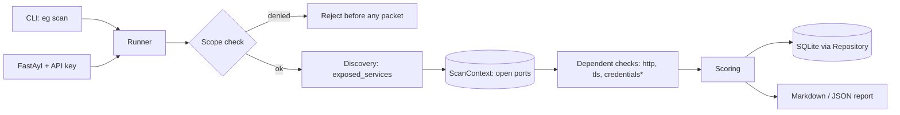

# Architecture

\* opt-in only.

## Design decisions

1. **Checks are plugins.** A check implements `Check.run(target, ctx) -> list[Finding]` and registers with `@register`. Adding a check never touches the runner.
2. **Two-phase run.** Discovery runs first and publishes open ports into `ScanContext`; dependent checks only probe ports that answered. This keeps traffic minimal. TCP discovery shares a bounded semaphore to cap connection fan-out across targets.
3. **Fail closed (current boundary).** The declared hostname/IP is checked against scope before the first connection. DNS answers are not yet pinned or revalidated at connection time; hostname-based scope is therefore not a complete DNS-rebinding defence. Track the required connection-level design in [issue #3](https://github.com/silvatechf/exposure_detect/issues/3).
4. **Checks never abort a scan.** The runner isolates exceptions and records them under `errors`.
5. **Persistence behind a Repository.** Summary columns are indexed for filtering; the full result is stored as JSON so the schema is stable while models evolve.
6. **Evidence minimisation.** Findings store what is needed to reproduce (e.g. `credential_pair` id), never secrets.
7. **Async I/O.** Connect probes and HTTP requests use asyncio with bounded concurrency.
8. **Input boundaries.** Targets are parsed as hostnames/IPs rather than URLs; scope YAML is schema-checked and fails closed. API schema publication is disabled by default.
