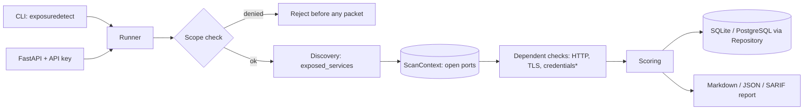

# Architecture

\* opt-in only.

## Design decisions

1. **Checks are plugins.** A check implements `Check.run(target, ctx) -> list[Finding]` and registers with `@register`. Adding a check never touches the runner.
2. **Two-phase run.** Discovery runs first and publishes open ports into `ScanContext`; dependent checks only probe ports that answered. This keeps traffic minimal. TCP discovery shares a bounded semaphore to cap connection fan-out across targets.
3. **Fail closed at connection time.** The runner checks the declared hostname/IP against scope, resolves each unique hostname once per scan, validates every answer against explicit deny rules, and completes preflight for all targets before any probe. TCP, UDP, TLS, and HTTP transports connect only to the immutable numeric-address snapshot. HTTP Host, TLS SNI, and certificate hostname validation retain the original hostname. Pinning does not protect against a malicious authoritative DNS answer returned during preflight; controlled DNS and restrictive egress controls remain necessary.
4. **Checks never abort a scan.** The runner isolates exceptions and records them under `errors`.
5. **Persistence behind a Repository.** Summary columns are indexed for filtering; the full result is stored as JSON so the schema is stable while models evolve. SQLite is the default; PostgreSQL is an optional deployment backend and its repository round-trip is covered by the CI PostgreSQL 16 service. `Base.metadata.create_all` creates missing tables but is not a schema migration system; introduce migrations before evolving persisted schemas across deployed versions.
6. **Evidence minimisation.** Findings store what is needed to reproduce (e.g. `credential_pair` id), never secrets.
7. **Async I/O.** Connect probes and HTTP requests use asyncio with bounded concurrency.
8. **Input boundaries.** Targets are parsed as hostnames/IPs rather than URLs; scope YAML is schema-checked and fails closed. API schema publication is disabled by default.
